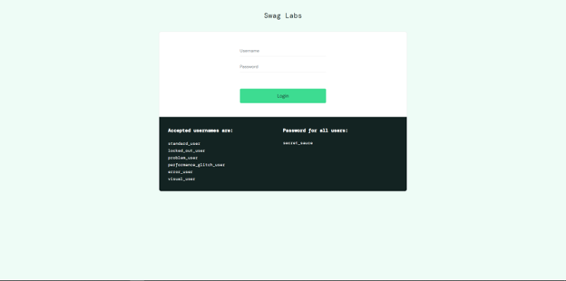
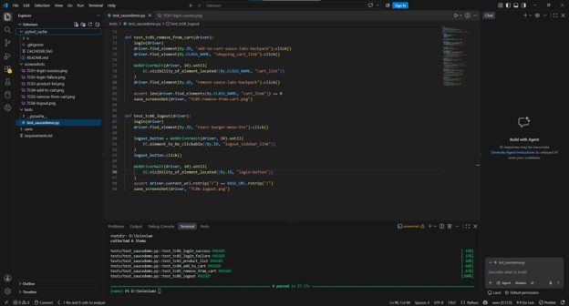
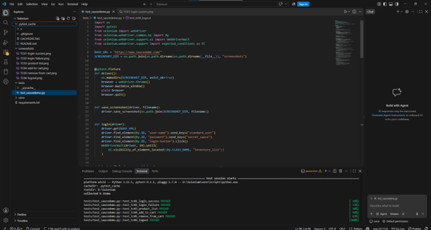
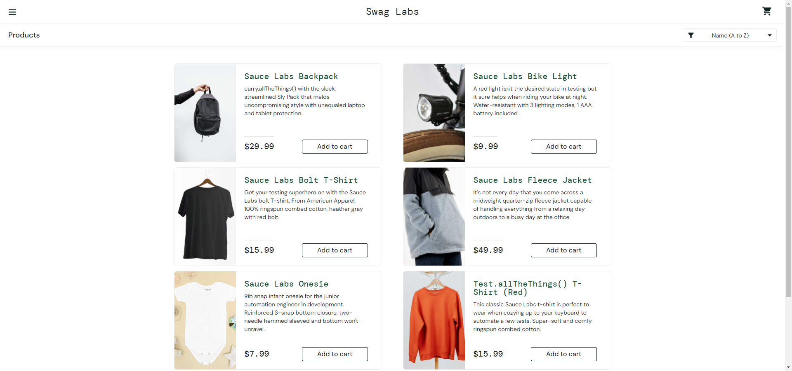
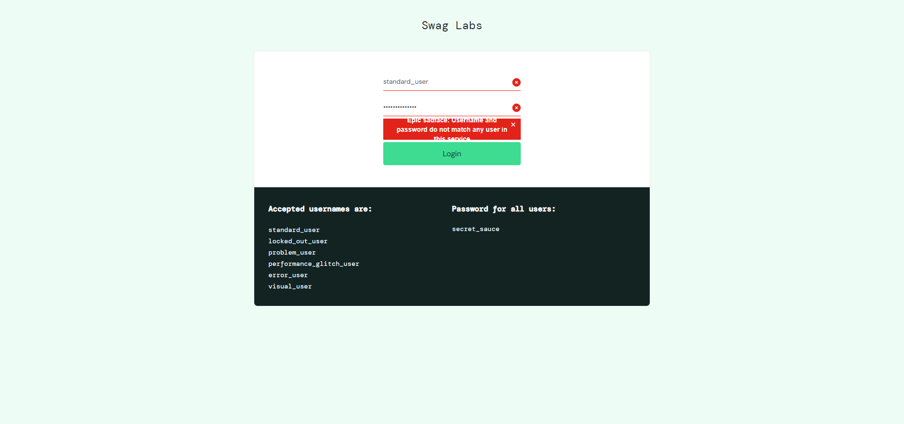
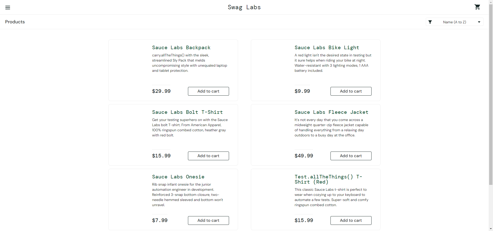
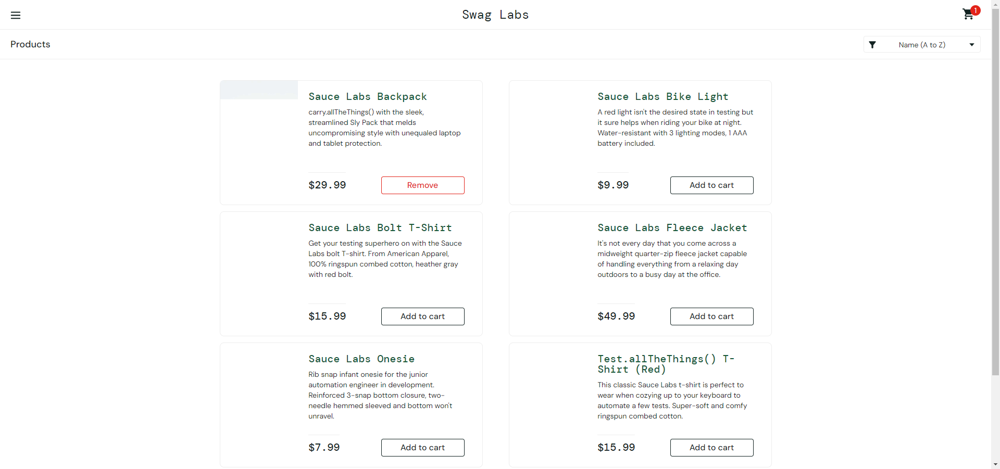
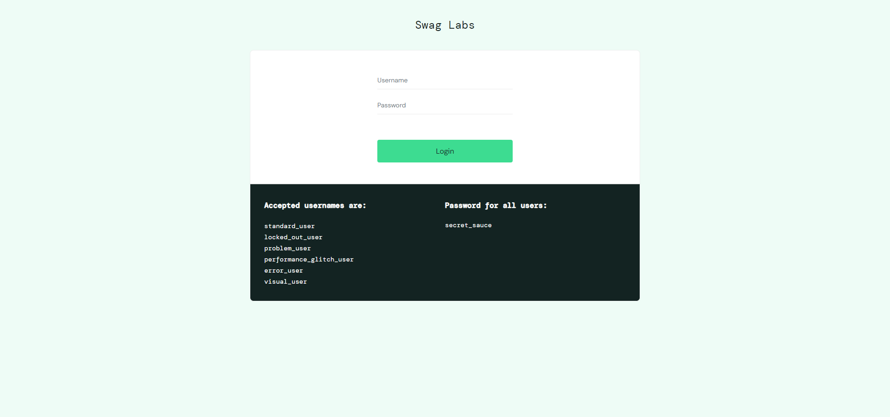
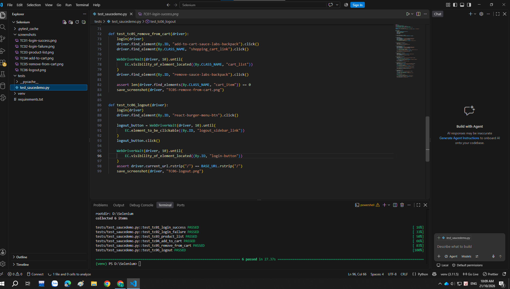

# Selenium Automation Testing

## 1. Giới thiệu

Dự án được thực hiện nhằm tìm hiểu và thực hành kiểm thử phần mềm tự động bằng Selenium WebDriver.

Trong dự án này, Selenium WebDriver được sử dụng để tự động hóa các thao tác trên trình duyệt Google Chrome, kết hợp với Python và Pytest để xây dựng, thực thi và đánh giá kết quả các test case.

Website được lựa chọn để kiểm thử là SauceDemo, một website mô phỏng hoạt động mua sắm trực tuyến. Các chức năng được kiểm thử bao gồm đăng nhập, hiển thị danh sách sản phẩm, quản lý giỏ hàng và đăng xuất.

**Website kiểm thử:** https://www.saucedemo.com/

## 2. Mục tiêu

- Tìm hiểu cách sử dụng Selenium WebDriver trong kiểm thử tự động.
- Thực hành viết các test case bằng ngôn ngữ Python.
- Sử dụng Pytest để tổ chức và thực thi các test case.
- Kiểm thử các chức năng cơ bản của website thương mại điện tử.
- Kiểm tra kết quả thực tế so với kết quả mong đợi.
- Lưu trữ mã nguồn, báo cáo và hình ảnh minh chứng trên GitHub.

## 3. Công nghệ sử dụng

| Công nghệ | Mục đích |
|---|---|
| Python | Ngôn ngữ lập trình để xây dựng test case |
| Selenium WebDriver | Tự động hóa thao tác trên trình duyệt |
| Pytest | Thực thi và quản lý các test case |
| Google Chrome | Trình duyệt được sử dụng để kiểm thử |
| Visual Studio Code | Môi trường viết và chạy mã nguồn |
| Git và GitHub | Quản lý mã nguồn và lưu trữ sản phẩm |

## 4. Môi trường thực hiện

- Hệ điều hành: Windows
- Ngôn ngữ lập trình: Python
- Công cụ kiểm thử: Selenium WebDriver
- Công cụ thực thi test: Pytest
- Website: SauceDemo

## 5. Cấu trúc dự án

```text
Selenium/
├── tests/
│   └── test_saucedemo.py
├── screenshots/
│   ├── 01-saucedemo-login.png
│   ├── 02-project-structure.png
│   ├── 03-selenium-source-code.png
│   ├── TC01-login-success.png
│   ├── TC02-login-failure.png
│   ├── TC03-product-list.png
│   ├── TC04-add-to-cart.png
│   ├── TC05-remove-from-cart.png
│   └── 10-test-results.png
├── requirements.txt
└── README.md
```

Thư mục `tests` chứa mã nguồn kiểm thử tự động.

Thư mục `screenshots` chứa các hình ảnh minh chứng cho giao diện website, mã nguồn và kết quả kiểm thử.

File `requirements.txt` lưu danh sách thư viện cần thiết để cài đặt môi trường.

File `README.md` trình bày báo cáo của dự án.

## 6. Cài đặt môi trường

### 6.1. Cài đặt thư viện

Sau khi cài đặt Python, mở Terminal tại thư mục dự án và thực hiện:

```bash
pip install -r requirements.txt
```

Các thư viện chính được sử dụng trong dự án là:

- selenium
- pytest

### 6.2. Chạy chương trình kiểm thử

Sử dụng lệnh sau để thực thi toàn bộ test case:

```bash
python -m pytest tests/test_saucedemo.py -v
```

Pytest sẽ lần lượt thực thi các test case và hiển thị trạng thái thành công hoặc thất bại trên Terminal.

## 7. Danh sách test case

Dự án xây dựng 6 test case kiểm thử tự động cho các chức năng cơ bản của website SauceDemo.

| Mã test case | Chức năng | Kết quả mong đợi |
|---|---|---|
| TC01 | Đăng nhập thành công | Người dùng truy cập được trang danh sách sản phẩm |
| TC02 | Đăng nhập thất bại | Website hiển thị thông báo lỗi khi nhập sai mật khẩu |
| TC03 | Hiển thị danh sách sản phẩm | Danh sách sản phẩm được hiển thị |
| TC04 | Thêm sản phẩm vào giỏ hàng | Số lượng sản phẩm trong giỏ hàng được cập nhật |
| TC05 | Xóa sản phẩm khỏi giỏ hàng | Sản phẩm được xóa khỏi giỏ hàng |
| TC06 | Đăng xuất | Người dùng được chuyển về trang đăng nhập |

## 8. Kết quả thực hiện và hình ảnh minh chứng

### 8.1. Giao diện website kiểm thử

Website SauceDemo được sử dụng làm đối tượng kiểm thử cho các chức năng đăng nhập, xem sản phẩm và quản lý giỏ hàng.



### 8.2. Cấu trúc dự án

Dự án được tổ chức thành các thư mục riêng biệt để quản lý mã nguồn kiểm thử, thư viện và hình ảnh minh chứng.



### 8.3. Mã nguồn Selenium

Mã nguồn được viết bằng Python, sử dụng Selenium WebDriver để thao tác trên trình duyệt và các câu lệnh assert để kiểm tra kết quả.



### 8.4. TC01 - Đăng nhập thành công

**Mục tiêu:** Kiểm tra chức năng đăng nhập bằng tài khoản hợp lệ.

**Các bước thực hiện:**
1. Mở website SauceDemo.
2. Nhập tên đăng nhập hợp lệ.
3. Nhập mật khẩu hợp lệ.
4. Nhấn nút đăng nhập.

**Kết quả mong đợi:** Website chuyển đến trang danh sách sản phẩm.

**Kết quả thực tế:** Test case PASSED.



### 8.5. TC02 - Đăng nhập thất bại

**Mục tiêu:** Kiểm tra khả năng xử lý khi người dùng nhập sai mật khẩu.

**Các bước thực hiện:**
1. Mở website SauceDemo.
2. Nhập tên đăng nhập hợp lệ.
3. Nhập mật khẩu không chính xác.
4. Nhấn nút đăng nhập.

**Kết quả mong đợi:** Website hiển thị thông báo lỗi và không cho phép đăng nhập.

**Kết quả thực tế:** Test case PASSED.



### 8.6. TC03 - Hiển thị danh sách sản phẩm

**Mục tiêu:** Kiểm tra danh sách sản phẩm sau khi đăng nhập thành công.

**Các bước thực hiện:**
1. Đăng nhập bằng tài khoản hợp lệ.
2. Truy cập trang danh sách sản phẩm.
3. Kiểm tra các sản phẩm được hiển thị.

**Kết quả mong đợi:** Danh sách sản phẩm xuất hiện trên trang.

**Kết quả thực tế:** Test case PASSED.



### 8.7. TC04 - Thêm sản phẩm vào giỏ hàng

**Mục tiêu:** Kiểm tra chức năng thêm sản phẩm vào giỏ hàng.

**Các bước thực hiện:**
1. Đăng nhập bằng tài khoản hợp lệ.
2. Chọn sản phẩm cần thêm.
3. Nhấn nút thêm vào giỏ hàng.
4. Kiểm tra số lượng sản phẩm trong giỏ hàng.

**Kết quả mong đợi:** Sản phẩm được thêm vào giỏ hàng và số lượng được cập nhật.

**Kết quả thực tế:** Test case PASSED.



### 8.8. TC05 - Xóa sản phẩm khỏi giỏ hàng

**Mục tiêu:** Kiểm tra chức năng xóa sản phẩm khỏi giỏ hàng.

**Các bước thực hiện:**
1. Đăng nhập bằng tài khoản hợp lệ.
2. Thêm sản phẩm vào giỏ hàng.
3. Mở trang giỏ hàng.
4. Nhấn nút xóa sản phẩm.
5. Kiểm tra giỏ hàng sau khi xóa.

**Kết quả mong đợi:** Sản phẩm bị xóa khỏi giỏ hàng.

**Kết quả thực tế:** Test case PASSED.


### 8.9. TC06 - Đăng xuất

**Mục tiêu:** Kiểm tra chức năng đăng xuất khỏi hệ thống.

**Các bước thực hiện:**
1. Đăng nhập bằng tài khoản hợp lệ.
2. Mở menu điều hướng.
3. Chọn chức năng đăng xuất.
4. Kiểm tra giao diện sau khi đăng xuất.

**Kết quả mong đợi:** Website quay lại trang đăng nhập.

**Kết quả thực tế:** Test case PASSED.



## 9. Kết quả kiểm thử tổng hợp

Các test case được thực thi bằng Pytest thông qua Terminal trong Visual Studio Code.

Kết quả chạy thực tế ghi nhận 6 test case đều thành công.

| Tổng số test case | Thành công | Thất bại |
|---:|---:|---:|
| 6 | 6 | 0 |



Kết quả trên cho thấy các chức năng được kiểm thử đều đáp ứng những điều kiện mong đợi đã được xác định trong mã nguồn.

## 10. Kết luận

Thông qua dự án, sinh viên đã thực hành sử dụng Selenium WebDriver để tự động hóa các thao tác trên trình duyệt Google Chrome.

Dự án đã xây dựng và thực thi 6 test case cho các chức năng đăng nhập, hiển thị danh sách sản phẩm, thêm sản phẩm vào giỏ hàng, xóa sản phẩm khỏi giỏ hàng và đăng xuất.

Việc kết hợp Python, Selenium WebDriver và Pytest giúp quá trình kiểm thử được thực hiện tự động, có thể chạy lại và kiểm tra kết quả một cách có hệ thống.

Qua bài thực hành, sinh viên củng cố kiến thức về kiểm thử phần mềm tự động, cách xây dựng test case và cách sử dụng GitHub để lưu trữ mã nguồn cùng báo cáo.
